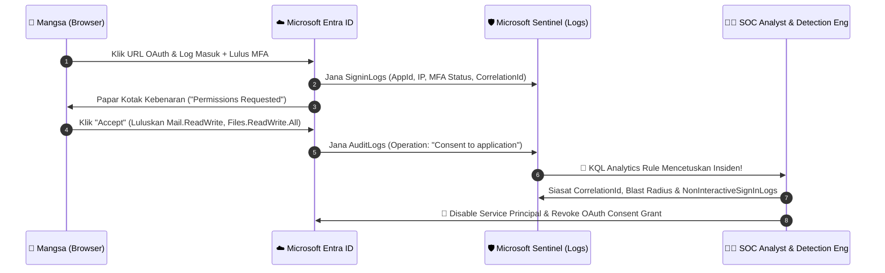

# 🛡️ Microsoft Entra ID: Illicit OAuth Consent Grant — Detection & SOC Investigation Lab


## 📌 Gambaran Keseluruhan Projek (Project Overview)

Projek ini mendokumentasikan aliran hujung-ke-hujung (**End-to-End Purple Team & SOC Lab**) bagi salah satu vektor serangan identiti awan paling kritikal masa kini: **Illicit OAuth Consent Grant (OAuth Phishing)** di dalam persekitaran **Microsoft Entra ID (dahulunya Azure AD)**.

Berbeza dengan serangan *phishing* tradisional yang cuba mencuri kata laluan dan sering dihalang oleh **Multi-Factor Authentication (MFA)**, serangan OAuth Phishing memperdaya pengguna untuk meluluskan aplikasi pihak ketiga (*Enterprise Application*) yang meminta kebenaran berisiko tinggi (seperti `Mail.ReadWrite` dan `Files.ReadWrite.All`). Sebaik sahaja diluluskan, penyerang memperoleh akses berterusan (*persistence*) ke atas data mangsa melalui Microsoft Graph API **tanpa perlu melepasi MFA lagi**, walaupun selepas mangsa menukar kata laluan.

### 🎯 Objektif Pembelajaran & Portfolio
1. **Purple Team / Lab Simulation:** Mensimulasikan aliran *OAuth Consent Grant* secara selamat di dalam tenant ujian Entra ID bagi menjana telemetri sebenar (`SigninLogs` & `AuditLogs`).
2. **Detection Engineering:**
   - Menganalisis struktur JSON kompleks di dalam kolum `TargetResources` pada `AuditLogs`.
   - Membangunkan **KQL Analytics Rule** untuk Microsoft Sentinel.
   - Membangunkan peraturan **Sigma (Detection-as-Code)** untuk kegunaan merentas SIEM.
3. **SOC L1/L2 Investigation & Incident Response:**
   - Menyediakan **Playbook Triage L1** dan **Threat Hunting L2** untuk mengenal pasti skop kompromi (*Blast Radius*).
   - Mendokumentasikan laporan siasatan insiden (*Incident Report*) dan langkah pemulihan (*Containment & Eradication*).

---

## 🗺️ Pemetaan MITRE ATT&CK (Cloud Matrix)

| Taktik (Tactic) | Teknik (Technique) | ID | Penerangan dalam Konteks Lab |
| :--- | :--- | :--- | :--- |
| **Initial Access** | Phishing: Spearphishing Link | `T1566.002` | Pengguna menerima pautan OAuth rasmi Microsoft (`login.microsoftonline.com`) yang meminta kelulusan aplikasi. |
| **Credential Access** | Steal Application Access Token | `T1528` | Penyerang memperoleh *OAuth Access Token* & *Refresh Token* selepas pengguna klik "Accept". |
| **Persistence** | Account Manipulation: Additional Cloud Roles | `T1098.003` | Kebenaran `offline_access` membolehkan aplikasi mengekalkan akses walaupun pengguna menukar kata laluan. |
| **Defense Evasion** | Use Alternate Authentication Material: Application Access Token | `T1550.001` | Akses data melalui Graph API menggunakan token aplikasi memintas keperluan MFA pengguna. |
| **Collection** | Email Collection: Remote Email Collection | `T1114.002` | Penyalahgunaan skop `Mail.ReadWrite` untuk membaca e-mel sensitif secara senyap. |

---

## 🏗️ Seni Bina Aliran Serangan & Telemetri



---

## 📂 Struktur Repositori

```text
entra-id-oauth-detection-lab/
├── README.md                                      # Dokumentasi utama projek
├── docs/
│   └── 01-lab-simulation-guide.md                 # Panduan langkah demi langkah simulasi selamat di Entra ID
├── detections/
│   ├── sentinel-illicit-consent-grant.kql         # Peraturan pengesanan KQL untuk Microsoft Sentinel
│   └── sigma-entra-illicit-consent-grant.yml      # Peraturan Sigma (Detection-as-Code)
├── sample-logs/
│   └── sample-auditlog-consent.json               # Contoh log mentah AuditLogs ("Consent to application")
├── playbooks/
│   └── soc-l1-l2-investigation-playbook.md        # SOP & Playbook Siasatan untuk SOC L1 dan L2
└── reports/
    └── sample-incident-report.md                  # Contoh Laporan Siasatan Insiden (Case Study)
```

---

## 🚀 Cara Menggunakan Projek Ini

1. **Bina Simulasi Lab:** Ikuti panduan di dalam [`docs/01-lab-simulation-guide.md`](./docs/01-lab-simulation-guide.md) untuk menjana telemetri di dalam tenant ujian Microsoft Entra ID anda.
2. **Fahami Struktur Log:** Semak [`sample-logs/sample-auditlog-consent.json`](./sample-logs/sample-auditlog-consent.json) untuk melihat bagaimana Entra ID merekodkan operasi `Consent to application`.
3. **Pasang Peraturan Pengesanan:** Gunakan [`detections/sentinel-illicit-consent-grant.kql`](./detections/sentinel-illicit-consent-grant.kql) di dalam Microsoft Sentinel untuk mencipta *Scheduled Analytics Rule*, atau rujuk [`detections/sigma-entra-illicit-consent-grant.yml`](./detections/sigma-entra-illicit-consent-grant.yml).
4. **Jalankan Siasatan SOC:** Gunakan [`playbooks/soc-l1-l2-investigation-playbook.md`](./playbooks/soc-l1-l2-investigation-playbook.md) untuk melakukan *triage* L1 dan *threat hunting* L2.
5. **Dokumentasikan Hasil:** Rujuk [`reports/sample-incident-report.md`](./reports/sample-incident-report.md) sebagai contoh laporan akhir siasatan.

---

## ⚠️ Penafian (Disclaimer)
Projek ini dibangunkan semata-mata untuk tujuan **pendidikan, pembangunan kemahiran Detection Engineering, dan latihan keselamatan siber (Defensive Security / SOC)**. Semua simulasi dijalankan di dalam persekitaran makmal terkawal menggunakan URI ubah hala tempatan (`localhost`) tanpa melibatkan sebarang kecurian token atau eksploitasi sebenar.
