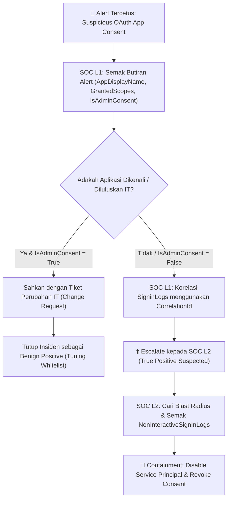

# 📘 Playbook Siasatan SOC (L1 & L2): Illicit OAuth Consent Grant

**ID Playbook:** `PB-ENTRA-001`  
**Nama Peraturan:** `Microsoft Entra ID - Suspicious OAuth Application Consent Grant`  
**Tahap Keterukan (Severity):** High  
**MITRE ATT&CK:** `T1528` (Steal Application Access Token), `T1098.003` (Additional Cloud Roles)

---

## 🧭 Aliran Kerja Triage & Siasatan (Decision Flowchart)



---

## 🔎 Fasa 1: Panduan Triage SOC Tier 1 (L1)

Matlamat SOC L1 adalah untuk mengesahkan sama ada kelulusan aplikasi ini adalah aktiviti perniagaan yang sah atau serangan *OAuth Phishing* dalam masa **15 minit**.

### Senarai Semak (Checklist) L1:
1. **Periksa Nama Aplikasi (`AppDisplayName`) & Publisher:**
   - Adakah nama aplikasi kelihatan generik atau mencurigakan (contoh: *PDF Viewer*, *Document Signer*, *Security Update*)?
   - Adakah URL/AppId di dalam `ServicePrincipalNames` merujuk kepada domain luar yang tidak dikenali atau `localhost`?
2. **Periksa Skop Kebenaran (`GrantedScopes`):**
   - Adakah skop yang diminta (`Mail.ReadWrite`, `Files.ReadWrite.All`, `offline_access`) melampaui fungsi aplikasi tersebut?
3. **Periksa Status Kelulusan (`IsAdminConsent`):**
   - Jika `IsAdminConsent == "False"`, ini bermakna pengguna biasa meluluskannya sendiri tanpa pengesahan pentadbir IT.
4. **Korelasi Sesi Log Masuk (`SigninLogs`):**
   Jalankan query KQL berikut menggunakan `CorrelationId` daripada alert untuk melihat konteks log masuk pengguna semasa menekan "Accept":

```kql
SigninLogs
| where CorrelationId == "<MASUKKAN_CORRELATION_ID_DARI_ALERT>"
| project
    TimeGenerated,
    UserPrincipalName,
    AppDisplayName,
    IPAddress,
    LocationDetails,
    DeviceDetail,
    AuthenticationRequirement,
    Status,
    UserAgent
```

### Kriteria Eskalasi ke SOC L2:
- **Escalate Serta-merta** jika `IsAdminConsent == "False"` DAN aplikasi tidak berada dalam senarai aplikasi rasmi syarikat DAN meminta skop `Mail.*`, `Files.*`, atau `Directory.*`.

---

## 🕵️‍♂️ Fasa 2: Siasatan Mendalam & Threat Hunting SOC Tier 2 (L2)

Apabila kes dieskalasi kepada L2, fokus beralih kepada menentukan **Blast Radius** (siapa lagi yang terjejas) dan **Post-Compromise Activity** (apa yang telah dilakukan oleh penyerang menggunakan token tersebut).

### 1. Kenal Pasti "Blast Radius" (Pengguna Lain yang Terpedaya)
Cari sama ada terdapat pengguna lain dalam organisasi yang turut meluluskan aplikasi yang sama dalam tempoh 30 hari lepas:

```kql
AuditLogs
| where TimeGenerated > ago(30d)
| where OperationName == "Consent to application"
| where tostring(TargetResources[0].displayName) == "<NAMA_APLIKASI_MENCURIGAKAN>"
    or tostring(TargetResources[0].id) == "<SERVICE_PRINCIPAL_ID>"
| extend InitiatedByUser = tostring(InitiatedBy.user.userPrincipalName)
| extend IpAddress = tostring(InitiatedBy.user.ipAddress)
| project TimeGenerated, InitiatedByUser, IpAddress, CorrelationId
```

### 2. Jejak Penyalahgunaan Token oleh Penyerang (`NonInteractiveUserSignInLogs`)
Selepas penyerang menerima *Access Token* dan *Refresh Token*, mereka akan mengakses akaun mangsa daripada infrastruktur mereka sendiri (tanpa interaksi pengguna). Semak log masuk *Non-Interactive*:

```kql
AADNonInteractiveUserSignInLogs
| where TimeGenerated > ago(7d)
| where AppDisplayName == "<NAMA_APLIKASI_MENCURIGAKAN>" or ServicePrincipalId == "<SERVICE_PRINCIPAL_ID>"
| summarize 
    SignInCount = count(),
    FirstSeen = min(TimeGenerated),
    LastSeen = max(TimeGenerated),
    IPs = make_set(IPAddress),
    Locations = make_set(Location)
    by UserPrincipalName, AppDisplayName, ResourceDisplayName
```
> 💡 **Petunjuk Kompromi (IoC):** Jika `IPs` atau `Locations` di dalam `AADNonInteractiveUserSignInLogs` berbeza dengan lokasi sebenar pengguna di dalam `SigninLogs`, ini membuktikan token sedang digunakan secara aktif dari pelayan penyerang!

### 3. Semak Sama Ada Penyerang Mencipta Peraturan Peti Masuk (BEC Persistence)
Jika aplikasi mempunyai kebenaran `Mail.ReadWrite` atau `MailboxSettings.ReadWrite`, semak `OfficeActivity` untuk melihat jika penyerang mencipta *Inbox Rule* bagi menyembunyikan e-mel:

```kql
OfficeActivity
| where TimeGenerated > ago(7d)
| where UserId == "<EMAIL_MANGSA>"
| where Operation in ("New-InboxRule", "Set-InboxRule", "UpdateInboxRules")
| project TimeGenerated, UserId, Operation, ClientIP, Parameters
```

---

## 🛑 Fasa 3: Pembendungan & Pemulihan (Containment & Eradication)

> ⚠️ **Amaran Penting untuk SOC:** Menukar kata laluan pengguna (**Password Reset**) **TIDAK AKAN** membatalkan akses aplikasi OAuth yang telah diluluskan! Anda wajib membatalkan kebenaran *Service Principal* tersebut.

### Langkah 1: Sekat Aplikasi daripada Log Masuk (Containment Serta-merta)
1. Buka **Microsoft Entra Admin Center** $\rightarrow$ **Identity** $\rightarrow$ **Applications** $\rightarrow$ **Enterprise applications**.
2. Cari aplikasi menggunakan nama (`AppDisplayName`) atau `ServicePrincipalId`.
3. Pergi ke **Properties** $\rightarrow$ tetapkan **Enabled for users to sign-in?** kepada **No** $\rightarrow$ klik **Save**.

### Langkah 2: Batalkan Kebenaran OAuth (Revoke OAuth Grant via PowerShell / Graph)
Pentadbir boleh membuang *OAuth2PermissionGrant* secara terus menggunakan modul **Microsoft Graph PowerShell**:

```powershell
Connect-MgGraph -Scopes "Directory.ReadWrite.All"

# Senaraikan kebenaran OAuth untuk Service Principal tersebut
Get-MgOauth2PermissionGrant -Filter "clientId eq '<SERVICE_PRINCIPAL_ID>'"

# Padam kebenaran OAuth (Revoke Consent)
Remove-MgOauth2PermissionGrant -OAuth2PermissionGrantId "<OAUTH2_PERMISSION_GRANT_ID>"
```

### Langkah 3: Batalkan Semua Sesi Refresh Token Pengguna
```powershell
Revoke-MgUserSignInSession -UserId "<EMAIL_MANGSA>"
```

### Langkah 4: Cadangan Pengerasan (Post-Incident Hardening)
- Hadkan *User Consent* kepada hanya aplikasi daripada penerbit yang disahkan (*Verified Publishers*) atau wajibkan aliran kerja **Admin Consent Request**.
